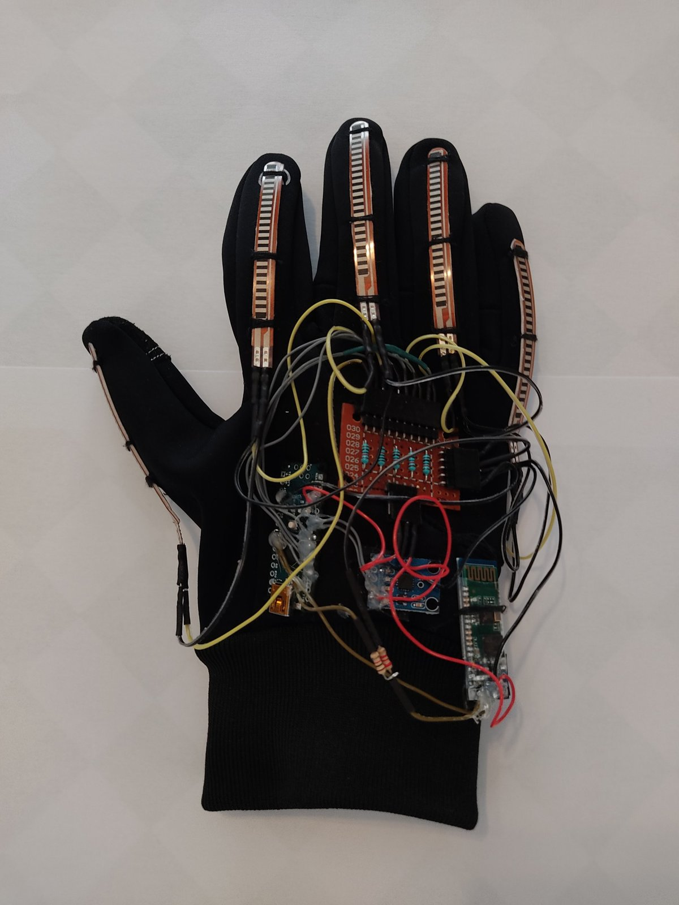
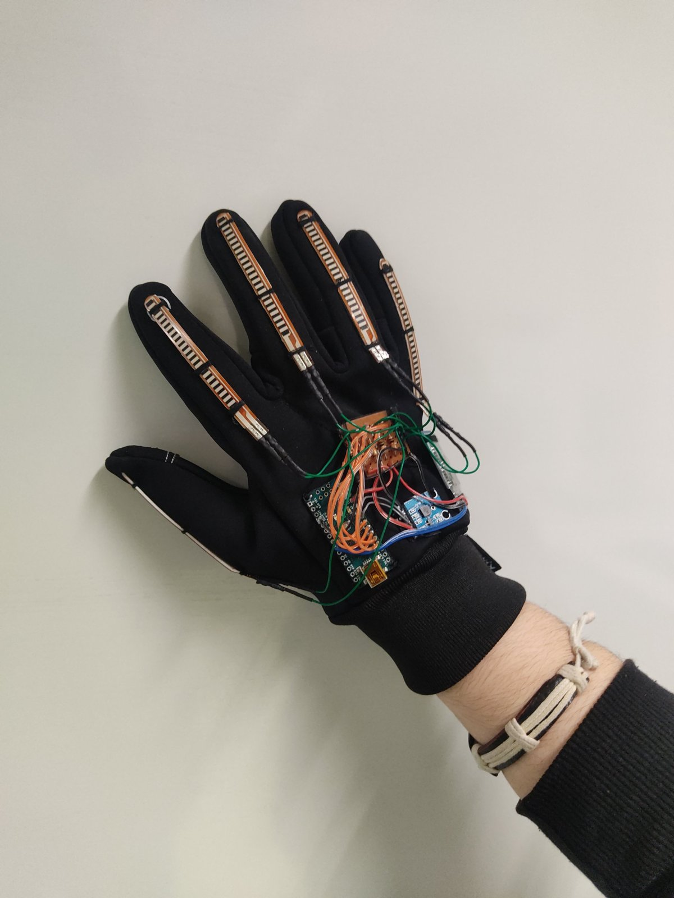
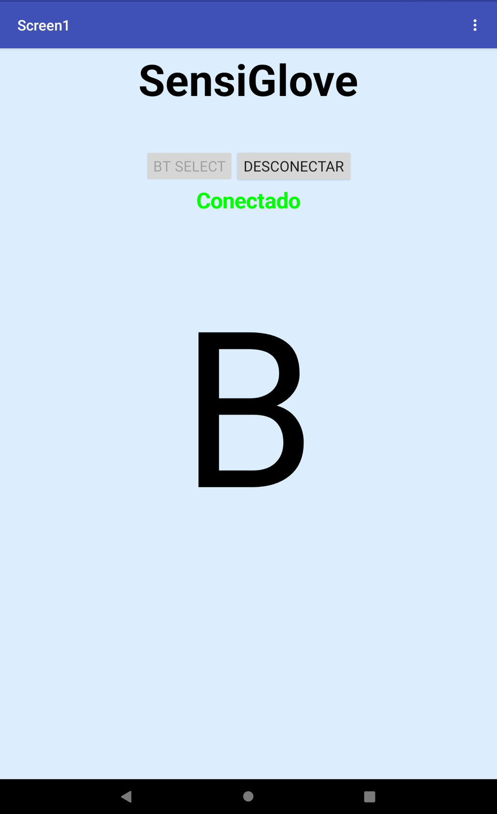
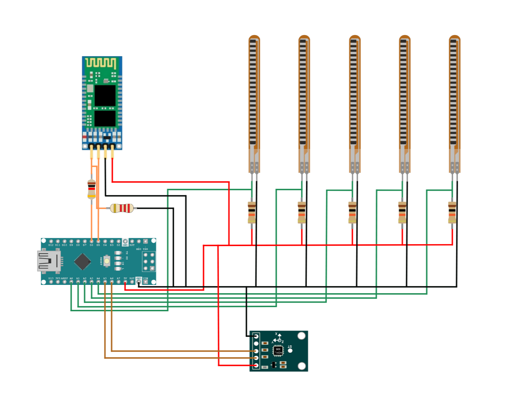

<h1 align="center">SensiGlove</h1>

<p align="center">
A sensor glove that translates Portuguese Sign Language (LGP) into text on an Android app, over Bluetooth.
</p>

<p align="center">
  
  
  
  
</p>

<p align="center">
  
</p>

<p align="center">
  
</p>

> Final project (_Prova de Aptidão Profissional_) for the vocational course _Técnico de Gestão de Equipamentos Informáticos_ at Agrupamento de Escolas de Ermesinde (school year 2024/2025). Individual project.

## How it works

1. **Sensing.** Five flex sensors (one per finger) measure how much each finger is bent, and an ADXL335 analog accelerometer measures the hand's tilt (X and Y axes).
2. **Processing.** An Arduino Nano reads the sensors on its analog pins, converts each flex reading to an angle between 0° and 90° using calibrated minimum and maximum values, and compares the five angles (plus X/Y for some letters) against a range defined for each letter.
3. **Transmission.** When a letter matches, the Arduino sends it over Bluetooth through an HC-06 module (9600 baud).
4. **Display.** An Android app built with MIT App Inventor 2 connects to the glove and shows the received letter on screen.

<table align="center">
  <tr>
    <td align="center"></td>
    <td align="center"></td>
  </tr>
  <tr>
    <td align="center">The glove being worn</td>
    <td align="center">The app displaying a recognized letter</td>
  </tr>
</table>

## Hardware

| Component                     | Role                                                |
| ----------------------------- | --------------------------------------------------- |
| Arduino Nano V3               | Microcontroller                                     |
| 5 × flex sensors (2.2")       | Finger bending                                      |
| ADXL335                       | Hand tilt (analog accelerometer, X/Y used)          |
| HC-06                         | Bluetooth link to the phone                         |
| 10 kΩ and 20 kΩ resistors     | Voltage dividers for the flex sensors and the HC-06 |
| Perfboard, AWG 28 wire, glove | Assembly                                            |

Wiring diagram: [`docs/images/schematic.png`](docs/images/schematic.png)

<p align="center">
  
</p>

Flex sensors are connected to `A0`–`A4`, the accelerometer's X and Y outputs to `A5` and `A6`, and the HC-06 to `D5` (RX) and `D6` (TX).

## Calibration

Each sensor's minimum and maximum reading was measured several times and averaged ([`docs/data/calibracao_sensores.xlsx`](docs/data/calibracao_sensores.xlsx)). The averaged values are hard-coded in the sketch, which avoids calibrating every time the glove is powered on. The runtime calibration routine is still in the code, commented out. The angle range defined for each letter is in [`docs/data/valores_angulos.xlsx`](docs/data/valores_angulos.xlsx).

## Recognized letters

**19 static letters:** A to Q, T and U.

## Limitations

This is a working prototype, not a finished product:

- It recognizes only the 19 letters above, not the full alphabet, and not words. Letters that need movement are not supported.
- Thresholds were tuned by hand, and readings depend on the user's hand, so the glove needs recalibrating for different people.
- Some letter ranges share boundary values (for example G and O, or K and U), so a reading exactly on a boundary can match two letters.
- The sketch reads the sensors every 500 ms with no filtering, so it can misread during transitions between gestures.
- Calibration values are fixed in the code.

## Repository structure

```
SensiGlove/
├── firmware/
│   ├── LICENSE                  # GPL-3.0 (firmware only)
│   └── sensiglove/
│       └── sensiglove.ino       # Arduino sketch
├── app/
│   └── SensiGlove.aia           # MIT App Inventor project
└── docs/
    ├── data/                    # Calibration data and angle ranges
    └── images/
```

## Build and run

1. Open `firmware/sensiglove/sensiglove.ino` in the Arduino IDE, select **Arduino Nano**, and upload it.
2. Power the glove and pair your phone with the HC-06 module.
3. Open the SensiGlove app (see [Android app](#android-app) below), select the HC-06 device and make the gestures.

## Android app

The app was built with MIT App Inventor 2 and is included in [`app/SensiGlove.aia`](app/SensiGlove.aia). To open it, go to _Projects > Import project (.aia) from my computer_ in App Inventor.

It lets you pick the paired HC-06 device, connects over Bluetooth, shows the connection status, and displays the last letter received. A timer checks for incoming text while connected.

## Author

Sofia Teixeira

## References

- Manmohan Gupta, [Sign Language Translator](https://github.com/satyamkr80/Sign_language_translator) (GPL-3.0)
- Hackster.io, [A Glove That Translate Sign Language Into Text and Speech](https://www.hackster.io/173799/a-glove-that-translate-sign-language-into-text-and-speech-c91b13)
- Ardumotive, [How to use a Flex Sensor](https://www.ardumotive.com/how-to-use-a-flex-sensor-en.html)
- DIY Planetleak, [Android receive data from arduino via HC-06 Bluetooth](https://www.youtube.com/watch?v=xjtxrxVauZg)

## License

The Android app (`app/`) and the remaining files are released under the [MIT License](LICENSE).

The firmware (`firmware/`) is derived from [Sign Language Translator](https://github.com/satyamkr80/Sign_language_translator) by Manmohan Gupta and is released under the [GPL-3.0](firmware/LICENSE).

Third-party materials (datasheets, trademarks) belong to their respective owners.

## Disclaimer

SensiGlove is an educational prototype. It is not a certified assistive device and does not replace sign language interpretation. It is provided as is, without warranty.
